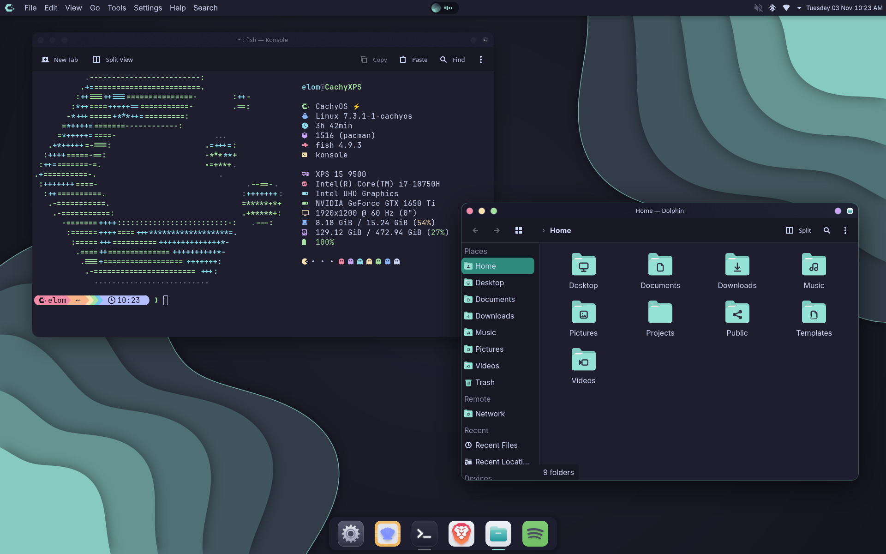
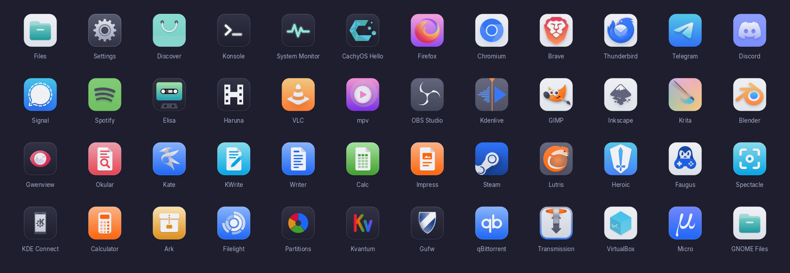
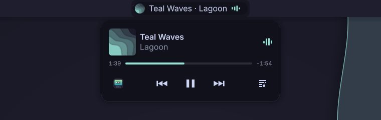

# Lagoon

A KDE Plasma 6 theme for CachyOS in the [Catppuccin](https://catppuccin.com) Mocha
palette with the Teal accent, with a matching GTK theme. Its Plasma theme started from
[CachyOS Nord](https://github.com/CachyOS/CachyOS-Nord-KDE).

Lagoon is an independent project: it is not made by, nor endorsed by, the CachyOS or the
Catppuccin teams.

It comes with [Teal](https://github.com/elomkdn/teal-icons), an icon theme in the same
colors, and [Teal Pill](https://github.com/elomkdn/teal-pill), a music island for the top bar:
everything in one download.



- **One accent everywhere**: buttons, check boxes, selections, text fields,
  progress and busy indicators all follow the color scheme's accent.
- **GTK and GNOME apps**: the libadwaita look, like Qt apps, with the same tones and
  teal selections, libadwaita apps included.
- **Layout**: a top bar and a floating dock, with System Settings, the terminal, your browser
  and your file manager (and Shelly and Spotify where they are installed). On the left of
  the top bar, the active app's name in bold, then its menus; the window's title is in its
  tooltip. In the middle, [Teal Pill](#teal-pill), included. Its launcher is
  [App Grid](https://appgrid.xarbit.dev) (`plasma6-applets-appgrid` in the AUR) if it is
  installed when the layout is applied, Plasma's own otherwise.
- **Translucent panels and popups**: the top bar, the dock, popups and tooltips let the
  blurred desktop show through, with smooth rounded corners and no outline. They turn
  opaque when KWin's blur effect is off, or when a panel is set to opaque.
- **Wallpapers**: Catppuccin waves and the CachyOS logo, and the same waves without the logo,
  for the lock screen. Both in 7 resolutions.
- **Terminal**: Konsole's colors in Mocha, through a *Lagoon* profile; a profile you chose
  already stays yours, and can take the *Lagoon* color scheme.
- **Splash screen**: the wallpaper's logo, whose bubbles float up from the C while
  the session loads, then fades into the desktop.
- **Window decoration**: Klassy with rounded corners, selected by the installer when it is
  installed, or Catppuccin Mocha Classic with square corners (see
  [Rounded windows](#rounded-windows)).
- **Icons**: [Teal](https://github.com/elomkdn/teal-icons), included and selected by default:
  app icons in Catppuccin colors, the apps' own logos, Papirus's system icons. To
  keep yours, install with `--no-icons`.
- **Cursors**: Catppuccin Mocha Teal, included.



*[Teal](https://github.com/elomkdn/teal-icons), the icon theme that comes with Lagoon.*

## Install

1. Get the theme, either way:

   - **A clone of the repository**: the installer builds the theme first (under a minute),
     with Python and librsvg alone, both there on CachyOS, and downloads the Teal icons. To
     update, `git pull` and run `./install.sh` again.

     ```sh
     git clone https://github.com/elomkdn/lagoon-kde.git
     cd lagoon-kde
     ./install.sh
     ```

   - **A release archive**: download `Lagoon.tar.gz` from the
     [releases](https://github.com/elomkdn/lagoon-kde/releases), extract it and run the
     installer in it. The theme is already built: it installs offline, with nothing else.

     ```sh
     tar -xzf Lagoon.tar.gz
     cd Lagoon
     ./install.sh
     ```

2. Recommended, not required: [Kvantum](https://github.com/tsujan/Kvantum)
   (`sudo pacman -S kvantum`), the style engine that gives Qt apps the theme's look;
   without it, they keep Breeze in the theme's colors.
3. At the end, the installer offers to apply Lagoon right away, and to replace your panels
   with its top bar and dock. Or, later, pick **Lagoon** in *System Settings → Colors &
   Themes → Global Theme*. Tick
   *Desktop and window layout* to get the top bar and dock, or add them one at a time:
   right-click the desktop, *Add Panel*, then **Lagoon Top Bar** or
   **Lagoon Dock**.
4. Recommended: rounded windows, like the rest of the theme, with
   [Klassy](#rounded-windows). Install it before Lagoon, or run the installer again after:

   ```sh
   paru -S klassy
   ./install.sh --apply
   ```

| Option | Effect |
|---|---|
| `--klassy` | Klassy with Lagoon's configuration in place of yours, see [Rounded windows](#rounded-windows) |
| `--no-klassy` | keeps the square decoration even if Klassy is installed |
| `--firefox` | Firefox's window buttons as the theme's red, yellow and green dots (restart Firefox) |
| `--no-icons` | keeps your icon theme: Teal is neither installed nor selected |
| `--apply` | applies Lagoon at the end without asking, keeping your panels and a wallpaper you chose |
| `--apply-layout` | applies Lagoon with its top bar and dock, in place of your panels |
| `--no-apply` | installs only, without asking: your icons, colors and panels stay as they are |
| `--uninstall` | the same as `./uninstall.sh` |

## Uninstall

```sh
./uninstall.sh
```

It removes Lagoon, Teal Pill and the Teal icons, and the settings the installer made: the
GTK theme and its window-buttons module, the Qt plugin for the Places panel, Flatpak apps' access to it, Kvantum's and Klassy's configurations (the ones you
had before come back) and Lagoon's Klassy preset, the terminal's profile, Firefox's dots. Catppuccin's cursors and window decoration stay if you
had them before Lagoon. If Lagoon is in use, Plasma first goes back to Breeze Dark; your
panels stay.

## Teal Pill



[Teal Pill](https://github.com/elomkdn/teal-pill) comes with Lagoon, in the middle of the top
bar: an island for every player that speaks MPRIS (Spotify, Elisa, Haruna, mpv, Firefox, Chromium, Brave…).

- **The pill**: the cover and bars that sway while music plays, in the cover's color; on hover,
  it widens to show the title. Middle click plays or pauses, the wheel sets the volume, the
  mouse's back and forward buttons skip.
- **The card**, on click: it comes out just under the pill, with the cover, the song, its
  progress between the times, previous, play/pause and next, a button that opens the player,
  and synced lyrics (from lrclib.net, only asked for when you open them). With several
  players open, each one is there to pick.
- **What else is going on**: the charger, headphones connecting (with their battery) or the
  power profile changing widen it for a moment; colored signs show while a microphone records
  (peach), a camera is in use (green) or the screen is shared (mauve), with the app's name
  in the tooltip and the card, and when the system was started from a snapshot (yellow);
  copies and downloads get a bubble of their own, their progress around it.

Its settings (right-click the pill, *Configure Teal Pill…*) choose the players to follow,
and these activities. It is also available on its own, for other themes.

## Rounded windows

Everything in the theme is rounded but the default window decoration: Catppuccin Mocha
Classic is an Aurorae theme, and Aurorae cannot tell KWin its corner radius (rounded
corners would leave the bottom of windows square and show the blur of translucent apps
in the corners). The global theme selects it because it needs nothing else installed.

The recommended decoration is [Klassy](https://github.com/paulmcauley/klassy), from the
AUR (`paru -S klassy`): KWin then rounds the whole window, blur included. A ready-made
Klassy configuration is included (`extras/klassy/klassyrc`): 15 px corners, matching
GTK windows and Plasma popups, the same red, yellow and green buttons, slightly
translucent title bar, a faint outline, and a deeper shadow on the active window.

When Klassy is installed, the installer selects it as it applies Lagoon. A Klassy
configuration of your own is kept; to take Lagoon's instead (yours is kept as
`klassyrc.bak`):

```sh
./install.sh --klassy
```

The installer also adds Lagoon to Klassy's presets: after changing a setting, Klassy's
settings > Presets > Lagoon > Load brings Lagoon's configuration back.

Applying the global theme from System Settings selects the Catppuccin decoration again, since
it has to work without Klassy: `./install.sh --apply` brings the rounded windows back.

## Kvantum

The theme's [Kvantum](https://github.com/tsujan/Kvantum) application style gives Qt apps
the look of GNOME apps, like the GTK theme: the global theme selects Kvantum, and
`install.sh` selects its Lagoon theme. It is based on
[KvLibadwaita](https://github.com/GabePoel/KvLibadwaita) Dark, in Catppuccin Mocha
with the teal accent, with the GTK theme's radii (9 px buttons, text fields, menus, list
and menu rows, tooltips; round toolbar buttons) at KvLibadwaita's density. Its tones
follow the color scheme, like Kirigami and GTK apps: window backgrounds, menu bars and
toolbars in mantle, views in base. Menus and tooltips are translucent and blurred in Mocha
base, like Plasma's popups; windows stay opaque.
Selections are teal with dark text, as in GTK and Kirigami apps, softer in inactive
windows.

## In this repository

The folders have the names of the places they install to, in `~/.local/share`; `build.sh`
fills them in (the translucent panels, the GTK and Kvantum themes, the wallpapers in every size,
the splash's backgrounds) and `install.sh` puts them in place.

```
plasma/desktoptheme/Lagoon     the Plasma theme; build-translucent.py beside it
plasma/look-and-feel/Lagoon    the global theme: settings, splash, previews
plasma/layout-templates        the top bar and the dock
plasma/plasmoids               Lagoon Title
gtk/                           the GTK theme's builder, and the GTK 3 module for the window buttons
kvantum/                       the Kvantum style's builder
qt/                            the Qt plugin for the Places panel
konsole/                       the terminal's colors and profile
wallpapers/                    the wallpaper's drawing, and its two packages
extras/                        Firefox and Klassy
vendor/                        the works Lagoon builds on (see CREDITS.md)
tools/                         checks, release, the pictures of the README
```

## License

[GPL-3.0-or-later](LICENSE). This theme builds on the work of CachyOS, Catppuccin,
Vince Liuice, GabePoel and lassekongo83: see [CREDITS.md](CREDITS.md).
